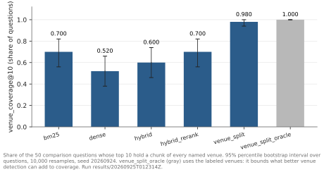

# crossvenue-rag

crossvenue-rag is a retrieval pipeline over the API documentation of seven crypto trading venues (Binance, Bybit, BingX, Hyperliquid, dYdX, Uniswap and PancakeSwap) and the CCXT client library. The venues document the same objects, such as orders, rate limits and funding, in near-identical words, so a RAG system can cite one venue's passage for another or miss a named venue altogether. In `results/20260925T012314Z` on `v0.2.1-gold`, retrieving once per named venue (`venue_split`) raises the share of the 50 comparison questions with every named venue in the top 10 from 0.70 to 0.98. The difference is +0.280 [+0.160, +0.400] (95% paired bootstrap), McNemar p < 0.001. `venue_split` was designed on these same questions ([methodology D13](evals/methodology.md#deviations-from-protocol)).



venue_coverage@10 of each method on the comparison questions of `v0.2.1-gold`, run `results/20260925T012314Z`.

## Results

Retrieval: `results/20260925T012314Z` on v0.2.1-gold; answers: `results/20260926T000001Z_judged`; 95% paired bootstrap intervals; n is the 50 comparison questions where a row names no other. Recall and answer coverage on the comparison questions are scored against gold augmented after results were seen ([methodology D4](evals/methodology.md#deviations-from-protocol)).

| Result | Details |
|---|---|
| 0.98 (49/50) with `venue_split` against 0.70 (35/50) with hybrid_rerank: the share of comparison questions with every named venue in the top 10, +0.280 [+0.160, +0.400], McNemar p < 0.001. venue_split retrieves once per named venue, and coverage is guaranteed when detection finds every named venue (47 of 50). Recall@10 −0.062 [−0.140, +0.006]: inconclusive at this size, with 80% power from a gap of 0.17, per `results/20260926T015648Z_power`. | [venue split](docs/results/findings.md#splitting-retrieval-by-venue-raises-comparison-coverage-from-070-to-098), [D13](evals/methodology.md#deviations-from-protocol) |
| +0.083 [−0.033, +0.198] recall@10 for hybrid_rerank − hybrid on the 50 comparison questions: a recall@10 loss above 0.033 from the reranker is excluded at 95%. venue_coverage@10 +0.100 [−0.060, +0.260]: a loss above 0.060 is excluded at 95%. | [reranker](docs/results/findings.md#against-hybrid-a-recall10-loss-above-0033-from-the-reranker-is-excluded-at-95) |
| 1 of 50 comparison questions put an unnamed exchange's chunk first with hybrid_rerank, 9 of 50 with BM25, CCXT pages counted apart (exploratory). hybrid_rerank − bm25 (both secondary): off-venue share@10 −0.178 [−0.226, −0.134], p_Holm < 0.001; top-1 off-venue rate −0.160 [−0.260, −0.060], p_Holm = 0.026. | [off-venue retrieval](docs/results/findings.md#unnamed-venues-fill-0036-of-hybrid_reranks-comparison-top-10-and-0214-of-bm25s-exploratory), [§9b](evals/methodology.md#9b-off-venue-retrieval-exploratory), [D16](evals/methodology.md#deviations-from-protocol) |
| −0.034 to −0.092: the change in every method's comparison recall@10 from `v0.2-gold` to `v0.2.1-gold`, where judging venue_split's and the oracle's unjudged top 20 adds 17 gold chunks, 13 from ranks 11–20. Recall@10 is measured within the labeling pool. | [pooling bias](docs/results/findings.md#adding-17-gold-chunks-changes-every-methods-comparison-recall10-by-0034-to-0092) |
| 2,505 ms of a 2,531 ms p50 query for hybrid_rerank is the cross-encoder, over the 114 questions; venue_split p50 3,094 ms. | [latency](docs/results/findings.md#the-cross-encoder-takes-2505-of-hybrid_reranks-2531-ms-at-p50) |
| 10.8% of chunk occurrences are byte-identical, 433 of the 536 groups Binance mainnet against `testnet/`: 12,783 occurrences stored as 11,934 chunks, every occurrence kept in `sources`. | [duplicate text](docs/results/findings.md#108-of-chunk-occurrences-are-byte-identical) |
| 0.440 over venue_split against 0.283 over hybrid_rerank: gemini's coverage of the comparison questions under prompt v1, +0.158 [+0.040, +0.279], p_Holm = 0.024. Coverage is the share of each venue's gold facts the answer states, averaged over the venues with gold facts. Under prompt v2 (exploratory), in `results/20260926T004836Z_judged`: +0.037 [−0.044, +0.117], p_Holm = 0.771, inconclusive at this size. | [answer coverage](docs/results/findings.md#under-prompt-v1-splitting-retrieval-by-venue-raises-answer-coverage), [D10, D16, D17 and D24](evals/methodology.md#deviations-from-protocol) |
| 2 of the 10 claims the human rejects are rejected by Opus as judge too, κ 0.238, on the 91 claims of the calibration answers in `results/20260925T175128Z_answers`. | [faithfulness](docs/results/findings.md#opus-as-judge-agrees-with-the-human-on-2-of-the-10-claims-the-human-rejects) |
| 0.143 median best-match TF-IDF cosine to Uniswap over the 2,021 PancakeSwap chunks, and no chunk above 0.7: PancakeSwap's documentation is its own text. | [PancakeSwap](docs/results/findings.md#pancakeswaps-median-best-match-cosine-to-uniswap-is-0143) |

## Status

- Built: corpus, indexes, six retrieval methods, evaluation harness, the frozen labeled set `v0.2.1-gold` (114 questions, 90 with gold chunks), and answer generation, where Opus (`anthropic/claude-opus-5.5` on OpenRouter) judges the answers of three generators.
- Round 2 (2026-10-10) reproduced the round-1 labels at κ 0.470 [0.317, 0.645] (95% percentile bootstrap over questions) over 750 decisions on 25 questions ([agreement](evals/agreement.md)). In an exploratory check, decided after round 2, the six-method evaluation on the adjudicated `v0.2.2-gold` (`results/20261010T214504Z`, against `results/20261010T222553Z` on `v0.2.1-gold`) changes no retrieval comparison's sign, significance or whether its interval excludes 0 ([sensitivity](docs/results/findings.md#on-v022-gold-no-retrieval-comparison-changes-sign-significance-or-whether-its-interval-excludes-0)). The comparisons are on the 50 comparison questions, the 59 multi-venue ones and the labeled ones, 92 in `v0.2.2-gold` and 90 in `v0.2.1-gold`.
- What limits these results: [Limitations](#limitations).

## Limitations

- One annotator labeled the questions and rated the calibration answers. Round 2 reproduced the labels at κ 0.470 over 750 decisions on 25 questions, below the registered target of 0.61, which makes the labels' reproducibility a limitation of `v0.2.1-gold` ([methodology §5](evals/methodology.md#5-annotator-agreement-with-one-annotator)).
- The set holds 114 questions, 50 of them comparison questions, so differences below the detectable gap are inconclusive at this size ([methodology §7](evals/methodology.md#7-set-size-and-statistical-power)).
- Opus meets the calibration threshold against human ratings on three of four dimensions on the point estimate and on the interval for coverage only ([judge calibration](docs/results/findings.md#the-judge-meets-three-of-four-thresholds-on-the-point-estimate-and-one-on-the-interval)).
- Results whose analysis was chosen after the data were seen are marked exploratory, and each such departure is a deviation ([methodology deviations](evals/methodology.md#deviations-from-protocol)).

## Why the documents are checked by code

`make reproduce` compares 2,582 values of the checked documents with their sources, table cells included ([design](docs/explanation/design.md#checking-the-documents-against-their-sources)). That is why `src/crossvenue_rag/reporting/` is the largest package in `src/`: it holds what each document claims and the tested functions that recompute the values.

## Requirements

- Python 3.12 or later and [uv](https://docs.astral.sh/uv/); `make install` creates the environment from `uv.lock` with the dev group and the `figures` extra (matplotlib), which `make lint` type-checks `scripts/` against and `make figures` draws with.
- Docker, for Postgres with pgvector (`docker-compose.yml`).
- The model weights of `BAAI/bge-base-en-v1.5` and `BAAI/bge-reranker-base` from Hugging Face: the tokenizer on the first `ingest`, the bi-encoder on the first `index`, and the reranker on the first reranked query (`eval`, `retrieve`, `ask`).
- An OpenRouter key, only for generating or judging answers; [Quick start](#quick-start) says where it goes.
- [Vale](https://vale.sh) for `make lint-docs`, [lychee](https://lychee.cli.rs) for `make lint-links`, and `jq` for the refusal-count snippets in [reproduce](docs/how-to/reproduce.md).

The runs the documents cite are committed under `results/`, so `make reproduce` and `make figures` read them directly; both also need `data/processed/`, which `make fetch ingest` builds. `make reproduce` also reads the `index_version` that `make index` records in `data/index/index_meta.json`. `make fetch` checks out the commit `data/manifest.csv` records for each git source and verifies every file's sha256, so it rebuilds this corpus after the sources have moved. The two GitBook sources cannot be fetched at a pinned version: `make fetch` compares every page with its recorded hash and stops with the count of differing pages per venue ([corpus datasheet](docs/reference/corpus.md#distribution)).

## Quick start

```bash
make install db fetch     # deps, Postgres + pgvector, the sources data/manifest.csv pins
make ingest index stats   # normalization, chunking, dedup, BM25 + pgvector, statistics
make retrieve Q="how often is funding paid on perpetuals" M=all
uv run crossvenue eval -q evals/datasets/v0.2.1-gold.jsonl   # six methods -> results/<ts>/
make test lint
make reproduce figures  # the checked documents' numbers, rechecked; the figures
```

Answers are generated through OpenRouter. The key is read from `OPENROUTER_API_KEY` in `.env`, a copy of `.env.example`:

```bash
make ask Q="how long does binance ban an ip that sends too many requests"
uv run crossvenue ask "..." --generator qwen --retriever hybrid_rerank
make serve                # POST /answer and GET /health on 127.0.0.1:8000
```

The answer lists each claim with its venue and the document and URL it cites, or says the documentation does not answer, or asks which venue is meant.

## Documentation

| Document | Type | Contents |
|---|---|---|
| [`docs/README.md`](docs/README.md) | table of contents | every document by type |
| [design](docs/explanation/design.md) | explanation | how the pipeline is built and why |
| [findings](docs/results/findings.md) | results | every result with its run |
| [directions](docs/explanation/directions.md) | explanation | nine development directions and the measured problem each addresses |
| [reproduce](docs/how-to/reproduce.md) | how-to | how to check the numbers of the documents `crossvenue reproduce` covers against their sources, and regenerate each |
| [corpus datasheet](docs/reference/corpus.md) | reference | sources, composition, preprocessing, licenses, gaps |
| [CLI](docs/reference/cli.md), [config](docs/reference/config.md) | reference | every command, option and config key |
| [`evals/README.md`](evals/README.md) | table of contents | methodology, domain research, gold-set datasheet, datasets, journals |
| [label](docs/how-to/label.md) | how-to | selecting, labeling, validating, versioning a question set |
| [ADRs](docs/adr/README.md) | decision records | the reason for each decision and what it replaces |

Writing rules: [`docs/style.md`](docs/style.md). Code rules: [`docs/code-style.md`](docs/code-style.md).

## Repository layout

```
src/crossvenue_rag/   the pipeline: fetch, chunk, index, retrieve, evaluate, label, answer, serve
configs/              default.yaml: every setting but those docs/reference/config.md names as kept in code
data/                 sources.yaml registry and manifest.csv (raw corpus not committed)
evals/                methodology, datasheet, questions, versioned datasets, journals, selection lists
docs/                 explanation/, reference/, results/, how-to/, adr/, style.md
tests/                no model weights, no database
Makefile              entry points (make install db fetch ingest index eval ask serve test lint)
prompts/              versioned generator and judge prompts
docker-compose.yml    Postgres + pgvector for the dense index; uv.lock pins the environment
```

Module-by-module detail is in [design](docs/explanation/design.md#module-layout).

## Tests

`make test` runs 1,957 tests in about 70 s of wall time on an Apple M5 with 10 cores, with no model weights, no database and no network: the embedder, reranker and model client are stubbed. It leaves out one slow test, the full mutation test of the documents' checks; `make check` runs lint, all 1,958 tests and `crossvenue reproduce` (about 270 s). CI runs `ruff`, `mypy`, `lint-imports`, Vale, lychee, `pytest` and `crossvenue validate-evals --skip-near-duplicates`.

## License

MIT for the code only. The documentation in `data/` belongs to the venues under the licenses recorded in [corpus datasheet](docs/reference/corpus.md#distribution); none of it is redistributed here.
