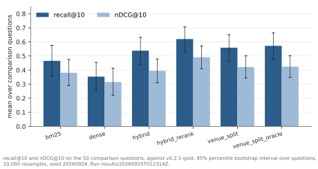
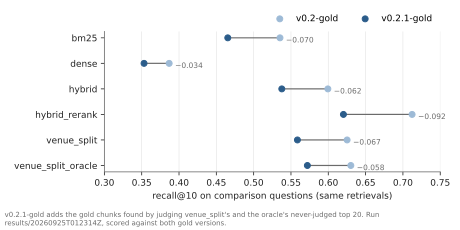
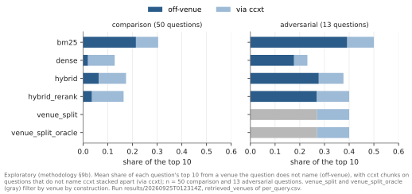
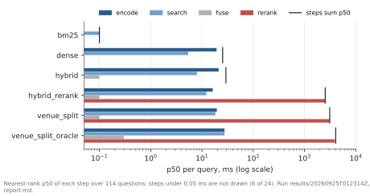
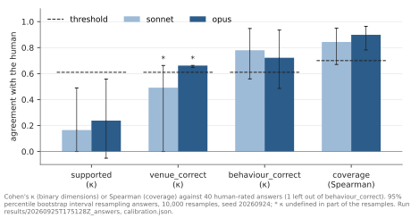
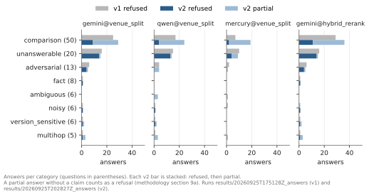
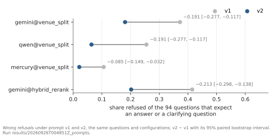

# Findings

Measured results, each with its run. Steps to regenerate its numbers are in [reproduce](../how-to/reproduce.md); `make reproduce` checks them against their sources ([design](../explanation/design.md#checking-the-documents-against-their-sources)), and `make figures` draws the figures from the same runs.

Retrieval is measured over the deduplicated index (11,934 chunks of seven trading venues and the CCXT library; the 1,665 documents of the manifest, 1,647 of which yield chunks; `index_version` `2825a7160c4d09bf`, manifest `c419b4be…`, in full in `evals/datasets/v0.2.1-gold.meta.json`) on the gold set `evals/datasets/v0.2.1-gold.jsonl` (114 questions, 90 with gold chunks, 277 gold chunks). Corpus properties are measured on the same index.

Of the 8 documentation sources, all have chunks that contain "order", 7 that contain "rate limit" (every source but PancakeSwap) and 7 that contain "funding" (every source but Binance), counted with `crossvenue count-term`. The retrieval run `results/20260925T012314Z` on `v0.2.1-gold` counts how often the most similar passage comes from a venue the question does not name. Substitution at the top rank is a first chunk from an exchange the question does not name, CCXT pages counted apart. It is rare on the 50 comparison questions for dense (0/50) and hybrid_rerank (1/50); BM25 substitutes on 9/50. A CCXT page comes first on dense 6/50, hybrid_rerank 6/50 and BM25 2/50. On the 13 adversarial questions every method without a venue filter substitutes on 3 or 4: BM25 4/13, dense 3/13, hybrid 4/13, hybrid_rerank 3/13; a CCXT page comes first on BM25 1/13, dense 2/13, hybrid 3/13 and hybrid_rerank 3/13. These off-venue counts are exploratory ([methodology §9b](../../evals/methodology.md#9b-off-venue-retrieval-exploratory)). A second failure is a named venue missing from the top 10: hybrid_rerank's venue_coverage@10 on the comparison questions is 0.70 (35/50), as [venue split](#splitting-retrieval-by-venue-raises-comparison-coverage-from-070-to-098) details. For dense, hybrid and hybrid_rerank, more of the comparison top 10 comes from CCXT's pages than from unnamed exchanges: 0.108 against 0.020, 0.110 against 0.064 and 0.128 against 0.036, a descriptive contrast. In the judged answers (`results/20260926T000001Z_judged` and `results/20260926T004836Z_judged`), all 34 claims Opus marks misattributed in both matrices cite a CCXT page for an exchange, the wrapper kind. The misattributed claims by kind are in [prompt v2 lowers wrong refusals](#prompt-v2-lowers-wrong-refusals-in-every-configuration-exploratory). This count is exploratory: prompt v2 was written after the v1 answers were read, and the kinds were added after the judged answers were read ([methodology D10 and D14](../../evals/methodology.md#deviations-from-protocol)).

## Results on v0.2.1-gold

Run `results/20260925T012314Z`: six methods, k = 10, `index_version` `2825a7160c4d09bf`, questions file sha256 `2105ce83…` (in full in the run's `index.json`; the 114 questions of `v0.2.1-gold`, 90 with gold chunks, 50 comparison). nDCG′@10 is from `results/20260925T015715Z`, and randomization-test p-values, Holm-adjusted p-values and the comparisons against dense and BM25 are from `results/20260925T132613Z`; every metric the runs share is identical. Paired intervals are 95% percentile intervals over 10,000 bootstrap resamples (seed 20260924); binary comparisons also use the exact McNemar test; `p_rand` is a two-sided paired randomization test (sign flip, 10,000 permutations, same seed).

The primary comparison is venue_split − hybrid_rerank on venue_coverage@10 over the comparison questions ([methodology §7](../../evals/methodology.md#7-set-size-and-statistical-power)), reported unadjusted. venue_split and this comparison were fixed after the `v0.2-gold` run had measured the coverage failure on the same 50 questions ([deviation D13](../../evals/methodology.md#deviations-from-protocol)). The test therefore measures the mechanism on the questions it was designed on, and no held-out set tests it. Recall, nDCG and `unjudged@10` on the comparison questions are scored against their gold, which was augmented after results were seen ([deviation D4](../../evals/methodology.md#deviations-from-protocol)). §7's rule that a result below δ is inconclusive was scoped to recall@10 on the comparison questions after results were seen, which decides how the effects below δ in this section are reported ([deviation D16](../../evals/methodology.md#deviations-from-protocol)). Every other comparison is secondary: `p_Holm` is its randomization p-value Holm-adjusted within its metric and scope, and a secondary result is called significant only when `p_Holm` < 0.05. Questions are cited as id plus their first six words.

### Splitting retrieval by venue raises comparison coverage from 0.70 to 0.98

`venue_split` was designed after the `v0.2-gold` run measured the coverage failure on these 50 questions, so this test is no independent confirmation of it. It fuses BM25 and dense candidates once per venue the question names, reranks them and interleaves the per-venue lists ([design](../explanation/design.md#retrieval), [ADR 0007](../adr/0007-venue-split.md)).

Run `results/20260925T012314Z` (nDCG′@10 from `results/20260925T015715Z`), `v0.2.1-gold`, the 50 comparison questions (deviations D4 and D13):

| method | recall@10 | nDCG@10 | nDCG′@10 | venue_coverage@10 |
|---|---:|---:|---:|---:|
| bm25 | 0.465 | 0.380 | 0.382 | 0.70 (35/50) |
| dense | 0.353 | 0.315 | 0.315 | 0.52 (26/50) |
| hybrid | 0.538 | 0.394 | 0.395 | 0.60 (30/50) |
| hybrid_rerank | 0.620 | 0.490 | 0.493 | 0.70 (35/50) |
| venue_split | 0.559 | 0.421 | 0.421 | 0.98 (49/50) |
| venue_split_oracle (oracle) | 0.572 | 0.424 | 0.424 | 1.00 (50/50) |

`venue_coverage@10` is the share of questions whose top 10 hold at least one chunk from every venue the question names; it needs no gold labels. nDCG′@10 is nDCG on the condensed list (Sakai 2007, [methodology references](../../evals/methodology.md#references)): never-judged chunks are dropped instead of scored as misses, within the retrieved top 10.

venue_split − hybrid_rerank:

- venue_coverage@10 (primary): +0.280 [+0.160, +0.400]; better on 14 questions, worse on none; McNemar p < 0.001, p_rand < 0.001. The split method puts each detected venue's first chunk into the top 10, so coverage is guaranteed whenever detection finds every named venue. Of the 49 covered comparison questions, 47 are covered that way; the other 2 fall back to hybrid_rerank and happen to cover. The result measures the detector and the split; whether the covered chunks are relevant is what recall@10 measures.
- recall@10 (secondary): −0.062 [−0.140, +0.006], p_Holm = 0.435; better on 4, worse on 10, tied on 36; inconclusive at this size. The test as run is a paired randomization on per-question recall@10, which is fractional for 156 of the family's 300 values, with Holm within a family of 6. A simulation with the family's observed discordance (127 of 300 question pairs differ) reaches 80% power from a gap of 0.17 when the comparison is Holm's first step and from 0.15 without adjustment (`results/20260926T015648Z_power`). The observed gap of 0.062 is below the 0.17 it detects. Recall here is scored against gold augmented after results were seen (D4).

Cost is measured with one cross-encoder call per named venue, the mode of this run; the code scores every venue's candidates in one call, benched below. Over all 114 questions p50 is 3,094 ms against 2,531 ms for hybrid_rerank, p95 6,335 ms against 3,298 ms. On the 48 questions venue_split splits, p50 is 5,408 ms against 2,466 ms for hybrid_rerank on the same questions. On those questions per-venue calls − one call is +311 ms [+168, +448] per query in the rerank step (bench, descriptive) ([latency](#the-cross-encoder-takes-2505-of-hybrid_reranks-2531-ms-at-p50)).

### Against hybrid, a recall@10 loss above 0.033 from the reranker is excluded at 95%

Paired differences with 95% paired bootstrap intervals, run `results/20260925T132613Z`, `v0.2.1-gold`, the 50 comparison questions (deviations D4 and D16):

| hybrid_rerank − | recall@10 | p_Holm | venue_coverage@10 | McNemar p | p_Holm |
|---|---:|---:|---:|---:|---:|
| hybrid | +0.083 [−0.033, +0.198] | 0.551 | +0.100 [−0.060, +0.260] | 0.332 | 0.997 |
| dense | +0.267 [+0.143, +0.388] | 0.001 | +0.180 [+0.020, +0.340] | 0.064 | 0.255 |
| bm25 | +0.155 [+0.021, +0.287] | 0.145 | +0.000 [−0.160, +0.160] | 1.000 | 1.000 |

No interval shows the reranker worse. Against hybrid, a loss larger than 0.033 in recall@10 or 0.060 in venue_coverage@10 is excluded at 95%, and both gains are inconclusive at this size (recall@10 reaches 80% power from a gap of 0.17). Against dense it finds more of the comparison gold, 26 questions better and 7 worse (p_Holm = 0.001). Against BM25 the comparison-recall difference is +0.155 [+0.021, +0.287] (21 better, 10 worse), p_Holm = 0.145, inconclusive at this size. The test reaches 80% power from a gap of 0.17. §7's rule reports an effect below δ as inconclusive, and it was scoped to recall@10 on the comparison questions after results were seen (D16). Over all 90 labeled questions the gain is +0.182 [+0.087, +0.277] (p_Holm = 0.004). Dense retrieval's venue_coverage@10 is 0.52 (26/50); hybrid_rerank − dense on venue_coverage@10 is +0.180 [+0.020, +0.340] (14 vs 5 discordant questions), p_Holm = 0.255, inconclusive at this size.

### Venue detection finds every named venue on 47 of 50 comparison questions

Venue detection is a dictionary of regex aliases per venue in `data/sources.yaml` (`uni v3`, `hl`, `pancake`, …; `bnb` is not an alias). The detector applied to the text of the 114 questions of `v0.2.1-gold`, against their labeled `venues`, with no retrieval run:

| questions | exact | partial | missed | wrong |
|---|---:|---:|---:|---:|
| comparison (50) | 47 | 2 | 1 | 0 |
| naming ≥ 2 venues (59) | 48 | 3 | 8 | 0 |
| all (114) | 95 | 3 | 16 | 0 |

All 16 missed questions name no venue in their text: the 6 ambiguous questions by design, and 10 that identify their venue only through an identifier or product term (`-1021`, `l2Book`, `STF`, `v4`). In run `results/20260925T132613Z`, venue_split_oracle − venue_split on venue_coverage@10: +0.020 [+0.000, +0.060] on comparison (1 vs 0), p_Holm = 1.000, inconclusive at this size. On all 59 multi-venue questions it is +0.102 [+0.034, +0.186] (6 vs 0), p_Holm = 0.119, inconclusive at this size. This effect below δ is judged by §7's Holm rule (D16). Of the 6 questions the oracle gains, 4 name no venue in their text and 2 name only one of the venues they concern.

### Adding 17 gold chunks changes every method's comparison recall@10 by −0.034 to −0.092

`v0.2.1-gold` contains 17 gold chunks found by judging the never-judged top 20 of venue_split and venue_split_oracle on the 50 comparison questions (534 chunks shown; 13 of the 17 at ranks 11–20; [ADR 0005](../adr/0005-labeling-pool.md)). `v0.2-gold` is the same set without them. The augmentation was decided after results were seen ([methodology D4](../../evals/methodology.md#deviations-from-protocol)). Recall@10 on the 50 comparison questions, the retrievals of `results/20260925T012314Z` scored against both (deviation D4):

| method | against v0.2-gold | against v0.2.1-gold | change |
|---|---:|---:|---:|
| bm25 | 0.535 | 0.465 | −0.070 |
| dense | 0.387 | 0.353 | −0.034 |
| hybrid | 0.599 | 0.538 | −0.062 |
| hybrid_rerank | 0.712 | 0.620 | −0.092 |
| venue_split | 0.625 | 0.559 | −0.067 |
| venue_split_oracle | 0.630 | 0.572 | −0.058 |

Every method's comparison recall@10 changes by −0.034 to −0.092 with the 17 chunks added. For venue_split and the oracle, whose top 10 on comparison is fully judged, the drop is a lower bound on the inflation, because the augmented pool is itself incomplete. For the four round-1 pool methods, whose comparison unjudged@10 is 0.032–0.088, further judging could move their recall either way. Recall values are comparable only within one gold version.

venue_split's gap to hybrid_rerank on recall@10 is −0.062 [−0.140, +0.006] against `v0.2.1-gold`, the secondary comparison above, on gold augmented after results were seen (D4). Against `v0.2-gold` it is −0.087 [−0.170, −0.016] in `results/20260925T002151Z`, the run of the same retrievals on `v0.2-gold`; the row is descriptive, since the registered comparison is on `v0.2.1-gold`. Of the 211 chunks in venue_split's and venue_split_oracle's top 10 that round 1 never judged, 4 are relevant.

Share of each method's top 10 that no judgment covers (`unjudged@10`), on the 90 labeled questions: bm25 0.076, dense 0.071, hybrid 0.034, hybrid_rerank 0.049, venue_split 0.031, venue_split_oracle 0.062; on the 50 comparison questions venue_split and venue_split_oracle are at 0.000, and bm25 0.088, dense 0.078, hybrid 0.032 and hybrid_rerank 0.032: round 1 judged the fused top 25 of the four round-1 pool methods, which leaves part of each one's own top 10 unjudged. Dropping the never-judged chunks from each ranking instead of counting them as irrelevant changes nDCG by nDCG′@10 − nDCG@10 on the 90 labeled questions: bm25 +0.001 (0.407 to 0.408), dense +0.006 (0.363 to 0.369), hybrid +0.001 (0.447 to 0.448), hybrid_rerank +0.003 (0.552 to 0.555), venue_split +0.001 (0.514 to 0.515), venue_split_oracle +0.008 (0.501 to 0.509): under 0.01 for every method.

### Unnamed venues fill 0.036 of hybrid_rerank's comparison top 10 and 0.214 of BM25's (exploratory)

Exploratory ([methodology §9b](../../evals/methodology.md#9b-off-venue-retrieval-exploratory)): the measure was defined after the results of `results/20260925T012314Z` were seen. Off-venue share@10 is the share of a question's top 10 whose venue the question does not name. A CCXT chunk (venue `ccxt`) on a question that does not name CCXT is counted apart, as via-ccxt share@10. Top-1 off-venue is whether the first chunk is off-venue, a CCXT chunk excluded; top-1 via-ccxt is whether the first chunk is a CCXT chunk on a question that does not name CCXT. All four are computed from the run's saved `retrieved_venues`, without running retrieval again. An off-venue chunk takes a slot in the top 10; it is not an error in an answer.

Off-venue measures, run `results/20260925T012314Z`, `v0.2.1-gold`, the 50 comparison questions:

| method | off-venue share@10 | via-ccxt share@10 | top-1 off-venue | top-1 via-ccxt | n |
|---|---:|---:|---:|---:|---:|
| bm25 | 0.214 | 0.090 | 0.18 (9/50) | 0.04 (2/50) | 50 |
| dense | 0.020 | 0.108 | 0.00 (0/50) | 0.12 (6/50) | 50 |
| hybrid | 0.064 | 0.110 | 0.02 (1/50) | 0.10 (5/50) | 50 |
| hybrid_rerank | 0.036 | 0.128 | 0.02 (1/50) | 0.12 (6/50) | 50 |
| venue_split | 0.000 | 0.000 | 0.00 (0/50) | 0.00 (0/50) | 50 |
| venue_split_oracle | 0.000 | 0.000 | 0.00 (0/50) | 0.00 (0/50) | 50 |

Off-venue measures, run `results/20260925T012314Z`, `v0.2.1-gold`, the 13 adversarial questions:

| method | off-venue share@10 | via-ccxt share@10 | top-1 off-venue | top-1 via-ccxt | n |
|---|---:|---:|---:|---:|---:|
| bm25 | 0.392 | 0.108 | 0.31 (4/13) | 0.08 (1/13) | 13 |
| dense | 0.177 | 0.054 | 0.23 (3/13) | 0.15 (2/13) | 13 |
| hybrid | 0.277 | 0.100 | 0.31 (4/13) | 0.23 (3/13) | 13 |
| hybrid_rerank | 0.269 | 0.131 | 0.23 (3/13) | 0.23 (3/13) | 13 |
| venue_split | 0.269 | 0.131 | 0.23 (3/13) | 0.23 (3/13) | 13 |
| venue_split_oracle | 0.269 | 0.131 | 0.23 (3/13) | 0.23 (3/13) | 13 |

venue_split and venue_split_oracle retrieve per named venue by construction, so their rows are descriptive. On the adversarial questions venue_split returns hybrid_rerank's top 10 on all 13 and the oracle on 12, so their rows equal hybrid_rerank's.

Run `results/20260925T012314Z`, `v0.2.1-gold`, 50 comparison and 13 adversarial questions. hybrid_rerank − each first-stage method, 95% paired bootstrap intervals and two-sided sign-flip randomization tests (10,000 resamples, seed 20260924), Holm-adjusted within each metric and scope (deviation D16); negative is fewer off-venue chunks for hybrid_rerank:

| hybrid_rerank − b, scope | off-venue share@10 | p_Holm | top-1 off-venue | McNemar p | p_Holm |
|---|---:|---:|---:|---:|---:|
| bm25, comparison | −0.178 [−0.226, −0.134] | < 0.001 | −0.160 [−0.260, −0.060] | 0.008 | 0.026 |
| dense, comparison | +0.016 [−0.010, +0.044] | 0.332 | +0.020 [+0.000, +0.060] | 1.000 | 1.000 |
| hybrid, comparison | −0.028 [−0.058, +0.000] | 0.200 | +0.000 [−0.060, +0.060] | 1.000 | 1.000 |
| bm25, adversarial (descriptive) | −0.123 [−0.246, +0.000] | - | −0.077 [−0.385, +0.231] | - | - |
| dense, adversarial (descriptive) | +0.092 [−0.015, +0.215] | - | +0.000 [+0.000, +0.000] | - | - |
| hybrid, adversarial (descriptive) | −0.008 [−0.123, +0.123] | - | −0.077 [−0.231, +0.000] | - | - |

On the comparison questions hybrid_rerank − bm25 is −0.178 [−0.226, −0.134] on off-venue share@10, p_Holm < 0.001, and −0.160 [−0.260, −0.060] on the top-1 off-venue rate, p_Holm = 0.026 (both secondary). Lower is better on both. hybrid_rerank has the smaller off-venue share on 36 questions, the larger on none and the same on 14. Where bm25's first chunk is off-venue, its own is not on 8 questions (a named venue on 7, a CCXT chunk on 1), with none the other way. Every comparison against dense and hybrid on the comparison questions is inconclusive at this size. The 13 adversarial questions are a category of fewer than 50 questions, so under [methodology §7](../../evals/methodology.md#7-set-size-and-statistical-power) their rows are descriptive: intervals only.

### The cross-encoder takes 2,505 of hybrid_rerank's 2,531 ms at p50

p50 / p95 in ms per query, run `results/20260925T012314Z`, the 114 questions of `v0.2.1-gold`, methods looped on the outside, models loaded before timing. The steps sum is the sum of the four measured steps, without the work between them ([design](../explanation/design.md#measuring-latency)). In this run venue_split called the cross-encoder once per named venue:

| method | encode | search | fuse | rerank | steps sum p50 | p95 |
|---|---:|---:|---:|---:|---:|---:|
| bm25 | 0.0 | 0.1 | 0.0 | 0.0 | 0.1 | 0.2 |
| dense | 19 | 5.4 | 0.0 | 0.0 | 25 | 48 |
| hybrid | 21 | 8.0 | 0.1 | 0.0 | 29 | 38 |
| hybrid_rerank | 16 | 12 | 0.1 | 2,505 | 2,531 | 3,298 |
| venue_split | 20 | 18 | 0.1 | 3,069 | 3,094 | 6,335 |
| venue_split_oracle | 28 | 28 | 0.3 | 3,906 | 4,046 | 7,612 |

venue_split scores all named venues' candidates in one cross-encoder call (`Reranker.rerank_many`); its retrievals, and every metric but latency in `results/20260925T144223Z`, are identical to the per-venue version. Run `results/20260925T225850Z_bench` (`crossvenue bench-rerank`) times both on the 48 questions of `v0.2.1-gold` where it splits, back to back for each question in alternating order, after the models are warmed up; ms per query:

| venue_split | calls per query | pairs per call | p50 | p95 | mean |
|---|---:|---:|---:|---:|---:|
| one call per venue | 2.0 | 50 | 5,659 | 7,487 | 5,519 |
| one call for all venues | 1.0 | 100 | 5,208 | 7,520 | 5,309 |

Paired by question, per-venue calls − one call is +311 ms [+168, +448] (95% paired bootstrap interval) in the rerank step; one call is faster on 40 of 48 questions. The 48 questions are a slice of fewer than 50, so under methodology §7 this comparison is descriptive. On the steps sum per-venue calls − one call is +210 ms [−83, +459], inconclusive at this size. The mode timed first in each pair spends more outside the rerank step (mean 284 ms against 70 ms). Both versions score the same 100 pairs per question and return the same retrieval on all 48 questions.

The machine was not idle: the 1-minute load average during timing had a median of 4.09 and a maximum of 5.00 on 10 CPUs. Each saved pair was timed between two checks that found no other `crossvenue`, `pytest` or `uvicorn` process, as the run's `BENCH.md` records, and 21 pairs that failed the second check were discarded and repeated. On the same 48 questions the evaluation run measured venue_split's p50 at 5,408 ms, 4.4% below the per-venue mode here (5,659 ms). Its 3,094 ms over all 114 questions includes the 66 questions venue_split answers as plain hybrid_rerank.

### Moving the code into subpackages changes no metric

Run `results/20260925T024237Z`, made after the code moved into subpackages ([ADR 0008](../adr/0008-package-structure.md)), and run `results/20260925T015715Z`, made before it, both on the 114 questions of `v0.2.1-gold`, have the same value in every metric column of `summary.csv`.

### Three limits on the retrieval results

- Small slices. Outside comparison the labeled categories have 4–11 questions (adversarial 11, fact 8, ambiguous 6, noisy 6, version_sensitive 5, multihop 4); their rows in the run's `report.md` are too small to interpret.
- One-sided gold. 15 of the 50 comparison questions have a venue recorded `missing_from_pool` or `absent_in_docs`; recall on them is measured against the side the pools found.
- Augmentation covers comparison questions only. On the six ambiguous questions, venue_split_oracle's unjudged@10 is 0.467; judging those chunks could move its recall there either way, as judging the comparison questions' chunks lowered it.

The steps that reproduce these numbers are in [results on v0.2.1-gold](../how-to/reproduce.md#run-the-retrieval-evaluation-on-v021-gold).

## Round 2 reproduces the round-1 labels at κ 0.470 [0.317, 0.645], below the 0.61 target

The judgment journal `evals/annotations/questions.rounds.json` (`crossvenue kappa`), `v0.2.1-gold`, 750 candidate decisions over the 25 questions of the round-2 sample. Round 2 re-judged the sample blind on 2026-10-10, 15.7 to 15.9 days after round 1, counting its augmentation as methodology §5 does. Intervals are 95% percentile bootstrap intervals over questions, 10,000 resamples (seed 20260924); [agreement](../../evals/agreement.md) has every count.

Raw agreement is 0.916 against 0.842 expected by chance. The registered target is κ ≥ 0.61, so under methodology §5 the agreement is a limitation of `v0.2.1-gold`. The 16 unexposed questions are those whose gold the answer-rating screen never showed. The four readings methodology §5 registers, from the journal `evals/annotations/questions.rounds.json` on `v0.2.1-gold`, with 95% percentile bootstrap intervals over questions, on 750 decisions over 25 questions or 470 over the 16 unexposed ones:

| reading | questions | κ |
|---|---:|---:|
| corrected, all questions (registered) | 25 | 0.470 [0.317, 0.645] |
| corrected, unexposed questions | 16 | 0.457 [0.283, 0.684] |
| first judged, all questions | 25 | 0.460 [0.318, 0.629] |
| first judged, unexposed questions | 16 | 0.457 [0.298, 0.683] |

Round 2 marks more pairs relevant: of the 63 disagreements, 13 are relevant in round 1 only and 50 in round 2 only. 3 of the 13 round-1-only pairs are source chunks, which round 1's screen marked and round 2's hid; no run separates the marker's effect.

The adjudication applied the criterion amended after round 2 ([methodology §5a](../../evals/methodology.md#amendment-of-2026-10-10)) to the 63 pairs: 46 decisions agree with round 1 and 17 with round 2. With the relabel of the D23 questions it changed the gold of 8 questions, which `v0.2.2-gold` holds ([deviation D25](../../evals/methodology.md#deviations-from-protocol)); κ stays computed on the unresolved rounds.

## On v0.2.2-gold no retrieval comparison changes sign, significance or whether its interval excludes 0

Exploratory: the check was decided after round 2, and the registered results stay on `v0.2.1-gold`. Runs `results/20261010T222553Z` on `v0.2.1-gold` and `results/20261010T214504Z` on `v0.2.2-gold`, one config, six methods, k = 10. Each run scores 50 comparison questions, 59 multi-venue ones and the labeled ones, 90 on `v0.2.1-gold` and 92 on `v0.2.2-gold`. Both ran on the CPU (`embedding.device=cpu`), since the MPS backend stalled. On the comparison questions the CPU run on `v0.2.1-gold` matches `results/20260925T132613Z` in recall@10 and venue_coverage@10, and its nDCG@10 differs in the fourth decimal.

Each method on the 50 comparison questions, in `results/20261010T222553Z` on `v0.2.1-gold` and `results/20261010T214504Z` on `v0.2.2-gold`:

| method | recall@10 v0.2.1 | recall@10 v0.2.2 | nDCG@10 v0.2.1 | nDCG@10 v0.2.2 | venue_coverage@10 v0.2.1 | venue_coverage@10 v0.2.2 |
|---|---:|---:|---:|---:|---:|---:|
| bm25 | 0.465 | 0.473 | 0.380 | 0.383 | 0.700 | 0.700 |
| dense | 0.353 | 0.354 | 0.315 | 0.315 | 0.520 | 0.520 |
| hybrid | 0.538 | 0.539 | 0.394 | 0.393 | 0.600 | 0.600 |
| hybrid_rerank | 0.620 | 0.622 | 0.490 | 0.495 | 0.700 | 0.700 |
| venue_split | 0.559 | 0.573 | 0.421 | 0.430 | 0.980 | 0.980 |
| venue_split_oracle | 0.572 | 0.586 | 0.424 | 0.432 | 1.000 | 1.000 |

The 12 venue_coverage@10 comparisons are identical in both runs, since venue_coverage needs no gold. The primary and 12 recall@10 comparisons of `results/20261010T222553Z` (`v0.2.1-gold`) and `results/20261010T214504Z` (`v0.2.2-gold`) on the 50 comparison and the 90 and 92 labeled questions, 95% paired bootstrap intervals, p_Holm (unadjusted for the primary):

| comparison | v0.2.1-gold | p | v0.2.2-gold | p |
|---|---:|---:|---:|---:|
| venue_split − hybrid_rerank, venue_coverage@10, comparison (primary) | +0.280 [+0.160, +0.400] | < 0.001 | +0.280 [+0.160, +0.400] | < 0.001 |
| venue_split − hybrid_rerank, recall@10, comparison | −0.062 [−0.140, +0.006] | 0.435 | −0.049 [−0.117, +0.013] | 0.597 |
| venue_split − hybrid_rerank, recall@10, labeled | −0.034 [−0.079, +0.003] | 0.238 | −0.027 [−0.064, +0.006] | 0.302 |
| venue_split_oracle − hybrid_rerank, recall@10, comparison | −0.048 [−0.130, +0.025] | 0.551 | −0.036 [−0.108, +0.032] | 0.647 |
| venue_split_oracle − hybrid_rerank, recall@10, labeled | −0.042 [−0.090, +0.000] | 0.238 | −0.037 [−0.080, +0.002] | 0.247 |
| venue_split_oracle − venue_split, recall@10, comparison | +0.013 [+0.000, +0.037] | 0.551 | +0.013 [+0.000, +0.037] | 0.647 |
| venue_split_oracle − venue_split, recall@10, labeled | −0.007 [−0.030, +0.013] | 0.627 | −0.010 [−0.032, +0.010] | 0.405 |
| hybrid_rerank − hybrid, recall@10, comparison | +0.083 [−0.033, +0.198] | 0.551 | +0.083 [−0.033, +0.198] | 0.597 |
| hybrid_rerank − hybrid, recall@10, labeled | +0.088 [+0.002, +0.174] | 0.202 | +0.100 [+0.018, +0.182] | 0.097 |
| hybrid_rerank − dense, recall@10, comparison | +0.267 [+0.143, +0.388] | 0.001 | +0.267 [+0.143, +0.388] | 0.001 |
| hybrid_rerank − dense, recall@10, labeled | +0.218 [+0.120, +0.316] | 0.002 | +0.228 [+0.133, +0.320] | < 0.001 |
| hybrid_rerank − bm25, recall@10, comparison | +0.155 [+0.021, +0.287] | 0.145 | +0.149 [+0.018, +0.278] | 0.151 |
| hybrid_rerank − bm25, recall@10, labeled | +0.182 [+0.087, +0.277] | 0.004 | +0.184 [+0.091, +0.278] | < 0.001 |

None of the 24 primary and secondary comparisons changes sign, significance at p_Holm < 0.05 or whether its interval excludes 0. Four keep an interval that excludes 0 with p_Holm above 0.05, so they stay inconclusive at this size. On recall@10 they are hybrid_rerank − hybrid over the labeled questions and hybrid_rerank − bm25 over the comparison questions. On venue_coverage@10 they are hybrid_rerank − dense over the comparison questions, +0.180 [+0.020, +0.340], p_Holm 0.255, and venue_split_oracle − venue_split over the multi-venue questions, +0.102 [+0.034, +0.186], p_Holm 0.119.

## PancakeSwap's median best-match cosine to Uniswap is 0.143

PancakeSwap v2 and v3 are forks of Uniswap v2 and v3, but PancakeSwap's documentation is its own text. Over TF-IDF, each of the 2,021 PancakeSwap chunks against its best match among the 1,782 Uniswap chunks:

| threshold | PancakeSwap chunks above it |
|---|---:|
| ≥ 0.9 | 0 of 2,021 |
| ≥ 0.7 | 0 of 2,021 |
| ≥ 0.6 | 1 of 2,021 |
| ≥ 0.5 | 9 of 2,021 |
| ≥ 0.4 | 34 of 2,021 |

Median best-match cosine: 0.143.

The two share concepts and differ in wording. They describe the same objects, product structure and questions, with different fee tiers (0.30% vs 0.25%), different chains, and Permit2 deployed at a different address on the same BSC chain.

The steps that reproduce these numbers are in [PancakeSwap against Uniswap](../how-to/reproduce.md#compare-pancakeswap-with-uniswap).

## 10.8% of chunk occurrences are byte-identical

The source documentation repeats itself verbatim. Of 12,783 chunk occurrences, 1,385 (10.8%) fall into 536 groups of byte-identical text; 433 of the groups are Binance mainnet pages against their `testnet/` copies, and no text occurs on two venues:

| venue | groups |
|---|---:|
| binance (all mainnet/testnet) | 433 |
| bybit | 40 |
| bingx | 21 |
| uniswap | 19 |
| pancakeswap | 13 |
| dydx | 9 |
| ccxt | 1 |

The largest page pairs are `testnet/web-socket-api.md` ↔ `web-socket-api.md` (144 groups), `rest-api.md` ↔ `testnet/rest-api.md` (101) and `fix-api.md` ↔ `testnet/fix-api.md` (84).

The index stores each group once, as one of 11,934 chunks that keeps every occurrence in `sources` ([design](../explanation/design.md#exact-deduplication), [ADR 0003](../adr/0003-exact-deduplication.md)).

The steps that reproduce these numbers are in [duplicate text](../how-to/reproduce.md#count-duplicate-text).

## Answer generation

Four configurations answer the 114 questions of `v0.2.1-gold` from their top 8 chunks: gemini, qwen and mercury over venue_split, and gemini over hybrid_rerank ([methodology §9](../../evals/methodology.md#9-answer-generation-and-judging-pre-registered)). Prompt v1 answers are `results/20260925T175128Z_answers`, which Opus judged in `results/20260926T000001Z_judged`. Only judge dimensions that meet their calibration threshold enter a result: coverage, on the point estimate and the interval; `behaviour_correct`, on the point estimate only; and venue_attribution_error, whose `venue_correct` dimension meets it on the point estimate only, with an interval that is not informative (below), and which is reported as unresolved. Faithfulness does not: the `report.md` and `paired.csv` of both judged runs predate the uncalibrated mark and show faithfulness with p-values and no mark, and those columns are uncalibrated and enter no result.

These decisions, made after data were seen, qualify the results of this section; each is a deviation in [methodology, deviations from protocol](../../evals/methodology.md#deviations-from-protocol):

- D4: coverage on the comparison questions is graded against their gold, and the refusals are grouped by it; that gold was augmented after retrieval results were seen.
- D10: prompt v2 was written after the v1 answers were read, so every v2 result is exploratory.
- D11: the outcome rule, which counts a partial answer with no claim as a refusal, was fixed after the v2 answers were read and before either matrix was judged.
- D14: the attribution kinds were added after the judged answers were read.
- D15: only Opus graded the calibration answers a second time, by an instruction written after both candidates' first gradings.
- D16: §7's rule for results below δ was scoped to recall@10 on the comparison questions after results were seen; the answer results are judged by the rules §9 and §9a register.
- D17: §9's coverage and `behaviour_correct` tests pair every judged record, refusals included, and its venue_attribution_error test pairs the answers that carry claims; the protocol's word "answered" was compared with that only after the results.
- D20: one answer was left out of `behaviour_correct` against the human after the agreement with it had been computed.

### The judge meets three of four thresholds on the point estimate and one on the interval

Two judge candidates graded the 40 answers of the calibration sample, drawn from the questions of `v0.2.1-gold`, which one annotator also rated (`evals/annotations/judge_ratings.jsonl`); run `results/20260925T175128Z_answers`, `calibration.json`. Agreement with the human, 95% percentile bootstrap intervals resampling answers (10,000 resamples, seed 20260924), `behaviour_correct` under deviation D20:

| dimension | threshold | sonnet | opus | sonnet vs opus |
|---|---|---:|---:|---:|
| `supported` (91 claims) | κ ≥ 0.61 | 0.165 [0.000, 0.490] | 0.238 [−0.051, 0.558] | 0.389 [0.000, 1.000] |
| `venue_correct` (91 claims) | κ ≥ 0.61 | 0.492 [0.000, 0.662] | 0.662 [0.647, 0.663] | 0.795 [0.000, 1.000] |
| `behaviour_correct` (39 answers; 40 between the judges) | κ ≥ 0.61 | 0.780 [0.559, 0.947] | 0.722 [0.486, 0.935] | 0.942 [0.805, 1.000] |
| coverage (34 answers) | Spearman ≥ 0.70 | 0.843 [0.670, 0.949] | 0.899 [0.782, 0.964] | 0.980 [0.930, 0.998] |

Opus meets three thresholds and Sonnet two, so Opus judges both matrices ([ADR 0010](../adr/0010-judge.md)). The share of identical verdicts is high on every binary dimension (0.872 to 0.989 for Opus). κ is low where one verdict is rare: the human marked 10 of 91 claims unsupported and 1 misattributed. `behaviour_correct` leaves out `qwen@venue_split` on `cv-0138 "swap fail STF error mean what"`, whose rating screen showed a wrong `asked_clarification` flag ([methodology §9](../../evals/methodology.md#calibration-result)). The exclusion was decided after the results were seen, when the agreement with the answer included had been computed ([methodology D20](../../evals/methodology.md#deviations-from-protocol)).

venue_attribution_error is not resolved by this calibration. Its judge dimension passes on 2 of 91 claims that either grader marked misattributed, 1 that both marked. Both claims are in one answer: `qwen@venue_split` on `cv-0121 "which bingx endpoint returns the usdt-m"`, whose two claims cite a CCXT chunk and name BingX. Resampling answers draws both claims or neither, so κ lies in [0.647, 0.663] or is undefined (undefined in 3,634 of the 10,000 resamples), and its interval above is near-degenerate and cannot establish the threshold. Both claims are of the wrapper kind ([methodology §9](../../evals/methodology.md#attribution-errors-by-kind-reporting-rule)); the sample holds no claim that moves one exchange's fact to another, so the calibration cannot show whether Opus finds that error. The 40 calibration answers also come from prompt v1: none is a partial answer and none of their 91 claims has the absence form, both of which v2 uses. Every result on venue_attribution_error below is read with this.

### Opus, as judge, agrees with the human on 2 of the 10 claims the human rejects

The human ratings of `supported` follow one criterion, written down after the rating was done ([directions](../explanation/directions.md#recalibrating-the-judge)). A claim is supported only if its cited chunk states all of it. A claim the chunk supports in part, whose number, date or identifier differs from the chunk, or that generalizes one example into a rule, is unsupported. Of the 10 claims the human marks unsupported, Opus agrees on 2 and Sonnet on 1; of the 81 the human accepts, Opus rejects 2 and Sonnet none. Faithfulness from the LLM judge enters no conclusion here.

The 8 claims Opus accepted and the human rejected, run `results/20260925T175128Z_answers`, the calibration sample of `v0.2.1-gold`, by what separates the claim from its chunk (this document's reading; the ratings carry no rationale):

| claim | answer | what the chunk does not state | kind |
|---|---|---|---|
| limit defaults to 20 for "Bybit v5 fiat convert trade history" | gemini@venue_split, `cv-0127 "whats the default page size on"` | "fiat"; the chunk is the convert history endpoint | qualifier not in the chunk |
| size defaults to 20 for "Bybit friend referral history" | mercury@venue_split, `cv-0127 "whats the default page size on"` | "history"; the chunk is the friend referral list | qualifier not in the chunk |
| limit accepts 1 to 1000, default 500, for "recent trade history" | mercury@venue_split, `cv-0067 "bybit caps limit at 1000, how"` | that the endpoint is spread trading history | qualifier not in the chunk |
| BingX announcements use page-number pagination | qwen@venue_split, `cv-0058 "bybit hands me a cursor, does"` | the pagination scheme; the chunk lists a `page` and a `total` field | example turned into a rule |
| Binance REST signs the query string unsorted and percent-encoded | qwen@venue_split, `cv-0060 "does bingx sign the same string"` | a rule; the chunk is one testnet example | example turned into a rule |
| Binance WebSocket signs keys sorted alphabetically | qwen@venue_split, `cv-0060 "does bingx sign the same string"` | a rule; the chunk is one example | example turned into a rule |
| Position, Reserves, TickBitmap and TickMath "also use hex error selectors" | qwen@venue_split, `cv-0131 "my v4 revert is a hex"` | how errors are returned; the chunks list selector values | example turned into a rule |
| listenKey documentation removed "as of 2025-10-24" | qwen@venue_split, `cv-0148 "do i still need a listenKey"` | that date; the text says "following the announcement from 2025-04-01" | date from a heading |

By kind, three add a qualifier the chunk does not carry, four turn an example or a field list into a rule, and one takes a date from a changelog heading instead of the sentence. The two claims Opus rejected and the human accepted are the same kind of judgment in the other direction. One is "BingX requires HMAC SHA256 signatures for all endpoints", from a chunk of the Coin-M reference (`cv-0060 "does bingx sign the same string"`). The other is an absence claim about dYdX API wallets (`cv-0089 "how do i approve an api"`). The judge and the human draw the line between a claim and its generalization in different places, in both directions; a check that needs no judge is in [directions](../explanation/directions.md#faithfulness-without-an-llm-judge).

Opus graded the 40 calibration answers a second time (`judgements_opus_r1.jsonl`); only Opus did, by an instruction written after both candidates' first gradings ([methodology D15](../../evals/methodology.md#deviations-from-protocol)). It agrees with itself on `supported` at κ 0.852 [0.000, 1.000], against 0.238 with the human, and on the other dimensions at κ 1.000 (`venue_correct`, `behaviour_correct`) and Spearman 0.964 [0.910, 0.990] (coverage). Its self-agreement on `supported` is inconclusive at this size; that it applies a different criterion from the human's is an expectation, which a larger repeated sample would test.

### Under prompt v1, splitting retrieval by venue raises answer coverage

The primary comparison, gemini@venue_split − gemini@hybrid_rerank on the 50 comparison questions of `v0.2.1-gold`, prompt v1, run `results/20260926T000001Z_judged`, both metrics in one Holm family, 95% paired bootstrap intervals (deviations D4, D16 and D17):

| metric | n | venue_split | hybrid_rerank | difference | p_rand | p_Holm |
|---|---:|---:|---:|---:|---:|---:|
| coverage | 50 | 0.440 | 0.283 | +0.158 [+0.040, +0.279] | 0.012 | 0.024 |
| venue_attribution_error | 17 | 0.000 | 0.000 | +0.000 [+0.000, +0.000] | 1.000 | 1.000 |

Under prompt v1, retrieving once per named venue raises coverage, the share of each venue's gold facts the answer states averaged over the venues with gold facts, by +0.158 [+0.040, +0.279], p_Holm = 0.024 ([D24](../../evals/methodology.md#deviations-from-protocol)). Under prompt v2 (exploratory) the same comparison is +0.037 [−0.044, +0.117], p_Holm = 0.771, inconclusive at this size ([prompt v2 lowers wrong refusals](#prompt-v2-lowers-wrong-refusals-in-every-configuration-exploratory)). venue_attribution_error is 0.000 for both: on the 17 questions where both answers carry claims, Opus marks no claim misattributed. On it the comparison is inconclusive at this size, +0.000 [+0.000, +0.000], p_Holm = 1.000, and the calibration above does not resolve the metric.

Coverage is graded on the answer text, a refusal's included. gemini@venue_split refuses 25 comparison questions and its refusals average coverage 0.199, since 7 of them state some of the gold facts before refusing. gemini@hybrid_rerank refuses 29, averaging 0.026. On the questions each answered, the two average 0.682 and 0.637.

### Qwen has the highest coverage (0.621) and Mercury refuses 7 of 50

Means per configuration, prompt v1, run `results/20260926T000001Z_judged` (`summary.csv`), `v0.2.1-gold` (deviation D4), the 50 comparison and all 114 questions. Each mean is over the judged answers that carry the metric: on all questions 89 or 90 answers for coverage, 113 or 114 for `behaviour_correct`, and the 59 to 101 answers with claims for venue_attribution_error:

| configuration | coverage, comparison | coverage, all | `behaviour_correct`, comparison | `behaviour_correct`, all | venue_attribution_error, all |
|---|---:|---:|---:|---:|---:|
| gemini@venue_split | 0.440 | 0.559 | 0.500 | 0.655 | 0.000 |
| qwen@venue_split | 0.621 | 0.666 | 0.680 | 0.754 | 0.037 |
| mercury@venue_split | 0.472 | 0.555 | 0.800 | 0.816 | 0.013 |
| gemini@hybrid_rerank | 0.283 | 0.476 | 0.420 | 0.623 | 0.000 |

Every other pair is secondary, Holm-adjusted within each metric and scope. Run `results/20260926T000001Z_judged`, `v0.2.1-gold`, the 50 comparison questions (a − b), 95% paired bootstrap intervals (deviations D4 and D16):

| a − b | coverage | p_Holm | `behaviour_correct` | p_Holm |
|---|---:|---:|---:|---:|
| gemini@venue_split − qwen@venue_split | −0.180 [−0.270, −0.096] | < 0.001 | −0.180 [−0.300, −0.060] | 0.033 |
| gemini@venue_split − mercury@venue_split | −0.032 [−0.122, +0.056] | 0.502 | −0.300 [−0.420, −0.180] | < 0.001 |
| gemini@venue_split − gemini@hybrid_rerank | primary | - | +0.080 [−0.060, +0.220] | 0.393 |
| qwen@venue_split − mercury@venue_split | +0.149 [+0.077, +0.221] | < 0.001 | −0.120 [−0.220, −0.020] | 0.144 |
| qwen@venue_split − gemini@hybrid_rerank | +0.338 [+0.207, +0.468] | < 0.001 | +0.260 [+0.120, +0.400] | 0.006 |
| mercury@venue_split − gemini@hybrid_rerank | +0.189 [+0.078, +0.305] | 0.004 | +0.380 [+0.240, +0.520] | < 0.001 |

Qwen has the highest coverage. Mercury refuses 7 of the 50 comparison questions, against 25 for gemini@venue_split; qwen@venue_split − mercury@venue_split on `behaviour_correct` is −0.120 [−0.220, −0.020], p_Holm = 0.144, inconclusive at this size (methodology D16).

The same pairs on venue_attribution_error follow; gemini@venue_split − gemini@hybrid_rerank on comparison is the primary comparison above. Run `results/20260926T000001Z_judged`, `v0.2.1-gold`, a − b over the n questions where both answers carry claims, among the 50 comparison and all 114 questions, 95% paired bootstrap intervals, p_Holm within each scope (deviation D16):

| a − b | n, comparison | comparison | p_Holm | n, all | all | p_Holm |
|---|---:|---:|---:|---:|---:|---:|
| gemini@venue_split − qwen@venue_split | 26 | +0.000 [+0.000, +0.000] | 1.000 | 63 | −0.042 [−0.095, +0.000] | 1.000 |
| gemini@venue_split − mercury@venue_split | 26 | +0.000 [+0.000, +0.000] | 1.000 | 63 | +0.000 [+0.000, +0.000] | 1.000 |
| gemini@venue_split − gemini@hybrid_rerank | 17 | +0.000 [+0.000, +0.000] | 1.000 | 54 | +0.000 [+0.000, +0.000] | 1.000 |
| qwen@venue_split − mercury@venue_split | 38 | +0.000 [+0.000, +0.000] | 1.000 | 84 | +0.038 [+0.006, +0.079] | 0.753 |
| qwen@venue_split − gemini@hybrid_rerank | 20 | +0.000 [+0.000, +0.000] | 1.000 | 58 | +0.046 [+0.000, +0.103] | 1.000 |
| mercury@venue_split − gemini@hybrid_rerank | 21 | +0.000 [+0.000, +0.000] | 1.000 | 59 | +0.000 [+0.000, +0.000] | 1.000 |

On the comparison questions no paired answer carries a claim Opus marks misattributed, so every pair is inconclusive at this size. On all questions the intervals of 5 pairs include 0, inconclusive at this size; qwen@venue_split − mercury@venue_split is +0.038 [+0.006, +0.079] with p_Holm = 0.753, inconclusive at this size.

### Under prompt v1, gemini@venue_split refuses 25 of the 50 comparison questions

Refusals by category and configuration (`refused` in each answer), with the behavior the questions expect; run `results/20260925T175128Z_answers`, `v0.2.1-gold`, n per category:

| category | n | expected | gemini@venue_split | qwen@venue_split | mercury@venue_split | gemini@hybrid_rerank |
|---|---:|---|---:|---:|---:|---:|
| comparison | 50 | answer | 25 | 17 | 7 | 29 |
| unanswerable | 20 | refuse | 16 | 15 | 10 | 16 |
| adversarial | 13 | answer | 6 | 4 | 2 | 6 |
| fact | 8 | answer | 1 | 0 | 0 | 1 |
| ambiguous | 6 | ask_clarification | 0 | 0 | 0 | 0 |
| noisy | 6 | answer | 1 | 1 | 1 | 1 |
| version_sensitive | 6 | answer | 1 | 1 | 0 | 1 |
| multihop | 5 | answer | 1 | 1 | 0 | 1 |
| all | 114 | 20 refuse | 51 | 39 | 20 | 55 |

On questions that expect an answer or a clarifying question, Gemini refuses 35 (venue_split) and 39 (hybrid_rerank) times, Qwen 24 and Mercury 10.

In 24 of the 25 comparison refusals of gemini@venue_split the context held chunks of every named venue (4 of each); in `cv-0166 "hyperliquid never sends me a 429,"` it held only Hyperliquid chunks. The 25 refusals by what the top 8 held, run `results/20260925T175128Z_answers` against the gold of `v0.2.1-gold` (deviation D4):

| group | refusals | gold chunks in the context |
|---|---:|---|
| a | 3 | for every named venue |
| b | 12 | for some named venues; in 5 of them the other venue has no gold at all (`missing_from_pool` or `absent_in_docs`) |
| c | 10 | for none; in 6 of them one venue has no gold at all |

Of the 25 refusals, 11 cite chunks as [n] in the refusal text itself, and the 25 carry 1 claim between them. On the same 25 questions Qwen answers 9 and Mercury 17.

Rule 5 of prompt v1 reads: "If the chunks do not contain the answer, refuse: set `refused` to true, say in `answer` what is missing, and give no claims." It allows a full answer or a refusal and nothing between. The expectation, which prompt v2 tests, is that a comparison with one side missing falls under "not containing the answer", and that "give no claims" leaves no claim for the side that is there. Questions whose expected answer is an absence (a capability one venue documents and the other does not) fall under the same rule. Prompt v2 replaces rule 5 with three outcomes, a partial answer among them, and also adds rule 6, an absence from an enumerated list as a citable claim ([methodology §9a](../../evals/methodology.md#9a-generator-prompt-v2-exploratory)). Under v2, an exploratory prompt, wrong refusals fall in every configuration ([prompt v2 lowers wrong refusals](#prompt-v2-lowers-wrong-refusals-in-every-configuration-exploratory)). The primary comparison stays on v1.

The steps that reproduce these numbers are in [answer refusals](../how-to/reproduce.md#count-answer-refusals).

### Prompt v2 lowers wrong refusals in every configuration (exploratory)

Exploratory ([methodology §9a](../../evals/methodology.md#9a-generator-prompt-v2-exploratory)): prompt v2 was written after reading the v1 answers (deviation D10), and the outcome rule was fixed after the v2 answers were read (deviation D11). Answers `results/20260925T202827Z_answers` (the same four configurations and parameters as v1), which Opus judged in `results/20260926T004836Z_judged`; the comparison with v1 is `results/20260926T004851Z_prompts`.

Refusals, v1 to v2, counted under the outcome rule of [methodology §9a](../../evals/methodology.md#outcome-rule), fixed after the v2 answers were read ([deviation D11](../../evals/methodology.md#deviations-from-protocol)): an answer flagged partial that carries no claim is a refusal. Runs `results/20260925T175128Z_answers` and `results/20260925T202827Z_answers`, `v0.2.1-gold`, n per category (deviations D10 and D11):

| category | n | expected | gemini@venue_split | qwen@venue_split | mercury@venue_split | gemini@hybrid_rerank |
|---|---:|---|---:|---:|---:|---:|
| comparison | 50 | answer | 25 to 9 | 17 to 4 | 7 to 2 | 29 to 11 |
| unanswerable | 20 | refuse | 16 to 14 | 15 to 13 | 10 to 4 | 16 to 14 |
| adversarial | 13 | answer | 6 to 4 | 4 to 0 | 2 to 0 | 6 to 4 |
| fact | 8 | answer | 1 to 1 | 0 to 0 | 0 to 0 | 1 to 1 |
| ambiguous | 6 | ask_clarification | 0 to 0 | 0 to 0 | 0 to 0 | 0 to 0 |
| noisy | 6 | answer | 1 to 1 | 1 to 1 | 1 to 0 | 1 to 1 |
| version_sensitive | 6 | answer | 1 to 1 | 1 to 1 | 0 to 0 | 1 to 1 |
| multihop | 5 | answer | 1 to 1 | 1 to 0 | 0 to 0 | 1 to 1 |
| all | 114 | 20 refuse | 51 to 31 | 39 to 19 | 20 to 6 | 55 to 33 |

Partial answers under v2 (v1 has none): comparison 20, 20, 17 and 25 in the column order above; unanswerable 1, 1, 5 and 1; all categories 25, 32, 25 and 30. Clarifying questions: Qwen 0 to 1 and Mercury 2 to 1, each on an ambiguous question under v2; Gemini asks none in either run.

Wrong refusals (refused where an answer or a clarifying question is expected, 94 questions), v1 to v2: gemini@venue_split 35 to 17, qwen 24 to 6, mercury 10 to 2, gemini@hybrid_rerank 39 to 19.

Of gemini@venue_split's 25 v1 comparison refusals, v2 gives group a 2 partial and 1 refusal, group b 10 partial and 2 refusals, group c 2 full, 2 partial and 6 refusals.

H-v2, v2 − v1 per configuration, run `results/20260926T004851Z_prompts`, `v0.2.1-gold`, paired on questions, each metric Holm-adjusted across the four configurations, 95% paired bootstrap intervals. Wrong refusals are over the 94 questions that expect an answer or a clarifying question (exact McNemar), counted under the outcome rule (deviation D11). Their effects below δ are judged by the rule of §9a (deviation D16). venue_attribution_error is over questions where both versions' answers carry claims (paired randomization; deviation D10):

| configuration | wrong refusals, v1 to v2 | difference | p_Holm | venue_attribution_error, v1 to v2 | n | difference | p_Holm |
|---|---:|---:|---:|---:|---:|---:|---:|
| gemini@venue_split | 0.372 to 0.181 | −0.191 [−0.277, −0.117] | < 0.001 | 0.000 to 0.022 | 62 | +0.022 [+0.000, +0.059] | 1.000 |
| qwen@venue_split | 0.255 to 0.064 | −0.191 [−0.277, −0.117] | < 0.001 | 0.038 to 0.052 | 84 | +0.014 [+0.000, +0.032] | 1.000 |
| mercury@venue_split | 0.106 to 0.021 | −0.085 [−0.149, −0.032] | 0.008 | 0.003 to 0.020 | 100 | +0.017 [+0.000, +0.043] | 1.000 |
| gemini@hybrid_rerank | 0.415 to 0.202 | −0.213 [−0.298, −0.138] | < 0.001 | 0.000 to 0.028 | 59 | +0.028 [+0.000, +0.073] | 1.000 |

Wrong refusals fall in every configuration, and on none of the 94 questions does v2 refuse where v1 did not. H-v2 holds on wrong refusals only. Its attribution guard is inconclusive at this size, with the intervals and p_Holm of the table's venue_attribution_error columns. Per configuration 2 or 3 questions change, so the smallest p an exact randomization test can reach is 0.500 or 0.250. The run's p-values, sampled from random sign flips, equal those floors up to sampling error, and all 10 of those changes go against v2. Its faithfulness guard cannot be tested, the judge dimension having failed calibration.

Misattributed claims by kind, exploratory under both prompts: the kinds were added after the judged answers were read ([methodology §9](../../evals/methodology.md#attribution-errors-by-kind-reporting-rule), deviation D14). Cross-exchange claims cite chunks of one exchange, or a CCXT page about one exchange, and name another; wrapper claims cite only CCXT's documentation of an exchange and name that exchange. venue_attribution_error is the mean, over answers with claims, of the share of claims misattributed. Judged runs `results/20260926T000001Z_judged` (v1) and `results/20260926T004836Z_judged` (v2), `v0.2.1-gold`, answers with claims per row (deviations D10 and D14):

| configuration, prompt | answers with claims | claims | cross-exchange | wrapper | venue_attribution_error |
|---|---:|---:|---:|---:|---:|
| gemini@venue_split, v1 | 63 | 163 | 0 | 0 | 0.000 |
| qwen@venue_split, v1 | 86 | 294 | 0 | 8 | 0.037 |
| mercury@venue_split, v1 | 101 | 303 | 0 | 4 | 0.013 |
| gemini@hybrid_rerank, v1 | 59 | 157 | 0 | 0 | 0.000 |
| gemini@venue_split, v2 | 83 | 209 | 0 | 2 | 0.016 |
| qwen@venue_split, v2 | 95 | 344 | 0 | 12 | 0.049 |
| mercury@venue_split, v2 | 108 | 335 | 0 | 5 | 0.019 |
| gemini@hybrid_rerank, v2 | 81 | 203 | 0 | 3 | 0.021 |

Every claim Opus marks misattributed in both matrices is of the wrapper kind; the calibration sample holds no cross-exchange claim, so whether Opus would mark one is unresolved. The 22 under v2 come from 8 questions, 4 of them labeled unanswerable. Two of those have answers in the corpus, `cv-0115 "does bybit have a mass cancel"` and `cv-0121 "which bingx endpoint returns the usdt-m"`, and are fact in `v0.2.2-gold`. `cv-0106 "which binance endpoint sets leverage on"` stays unanswerable there, as its note says: the corpus has no Binance futures documentation, and CCXT's `setLeverage` chunk names Binance's page without the endpoint ([datasheet](../../evals/datasheet.md#known-limitations)). Every count on unanswerable questions here is on `v0.2.1-gold` and includes them as labeled.

Under v2, gemini@venue_split − gemini@hybrid_rerank on the 50 comparison questions (§9a's secondary comparison, Holm within the two metrics): coverage +0.037 [−0.044, +0.117], p_rand 0.386. On venue_attribution_error it is −0.009 [−0.026, +0.000] on the 38 questions where both v2 answers carry claims, p_rand 1.000. Both are inconclusive at this size (p_Holm 0.771 and 1.000). Under v1 the coverage difference is +0.158 [+0.040, +0.279], p_Holm = 0.024.

Two checks not registered in §9a, added after reading the v2 answers:

- Unsupported claims by Mercury on unanswerable questions cannot be tested: `supported` failed calibration. `behaviour_correct` passes calibration on the point estimate only, and no calibration answer is a partial answer. Mercury refuses 4 of the 20 unanswerable questions under v2, against 10 under v1. Opus grades its behavior correct on 10 of them under v2, against 12 under v1. The 20 unanswerable questions are a category of fewer than 50, so under methodology §7 the counts carry no p-value. 5 of its 16 non-refusals are partial answers, and 4 of its answers flagged partial carry no claim; the outcome rule counts those as refusals in every table here (deviation D11).
- An invented second side: of the 112 v2 answers counted as partial, 3 carry a claim Opus marks misattributed, all 3 of them the CCXT case above. Checked from the records alone, every claim a partial answer attributes to an exchange cites a chunk of that exchange or of CCXT. The `missing` field names a venue the answer cannot cover and what its documentation lacks there. A venue can be missing in part, so a claim about a venue listed there is not by itself an invention.

71 of the 1,095 v2 claims contain "does not list", the absence form of rule 6. The attribution table above counts 4 fewer: those 4 claims are in answers whose judgment failed.

Cost and generator call duration per configuration, v1 to v2, the 114 questions of `v0.2.1-gold`. Generator columns are from the answer runs `results/20260925T175128Z_answers` and `results/20260925T202827Z_answers`, the judge column from the judged runs `results/20260926T000001Z_judged` and `results/20260926T004836Z_judged`. Each is the cost of that configuration's calls, a cached call carrying the cost paid when it was made:

| configuration | generator, USD | judge, USD | p50, s | p95, s | output tokens | invalid responses (v2) |
|---|---:|---:|---:|---:|---:|---:|
| gemini@venue_split | 0.378 to 0.450 | 2.589 to 2.936 | 3 to 4 | 6 to 10 | 21,304 to 29,656 | 3 |
| qwen@venue_split | 0.198 to 0.238 | 3.579 to 3.693 | 21 to 20 | 72 to 54 | 30,319 to 41,576 | 0 |
| mercury@venue_split | 0.026 to 0.030 | 3.529 to 3.630 | 2 to 2 | 122 to 122 | 35,860 to 45,203 | 10 |
| gemini@hybrid_rerank | 0.366 to 0.439 | 2.735 to 2.867 | 3 to 4 | 6 to 8 | 20,169 to 28,965 | 1 |

The judge costs 7 to 138 times what the generator costs per answer. The judgments paid for, as the judged runs record them: $9.943 for v1 (105 calls served from the cache, the 40 calibration answers among them) and $11.695 for v2 (67 cached). The p50 per judge call is 6 s for v1 and 7 s for v2. The calibration cost $0.657 (Sonnet), $1.182 (Opus) and $1.255 (the Opus repeat). The 3 judgments that stayed invalid after two retries are recorded as judge errors and their calls carry no cost in the records.

Costs are the full cost of each configuration's answers. The gemini@hybrid_rerank configuration shares 66 cached calls with gemini@venue_split, so v2 spent $0.909 on uncached calls. Mercury's p95 is its calls with an invalid response: 6 of its 8 such calls took over 120 s under v2 (the longest 243 s, with two invalid responses), and 7 of 7 under v1.
